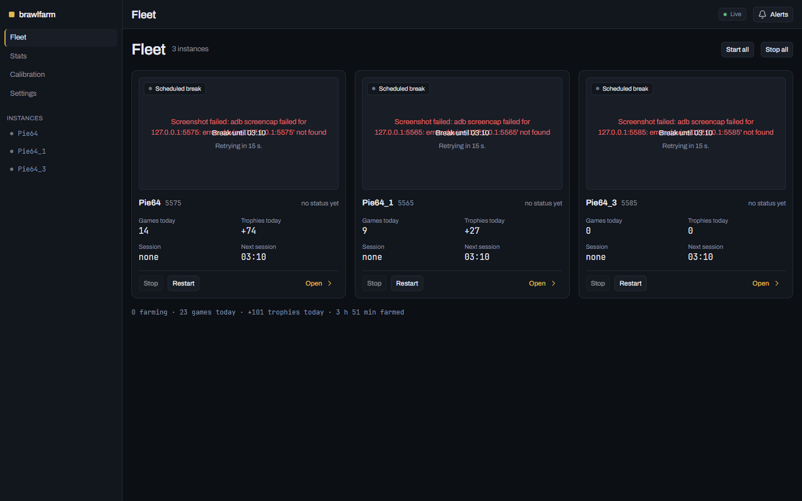
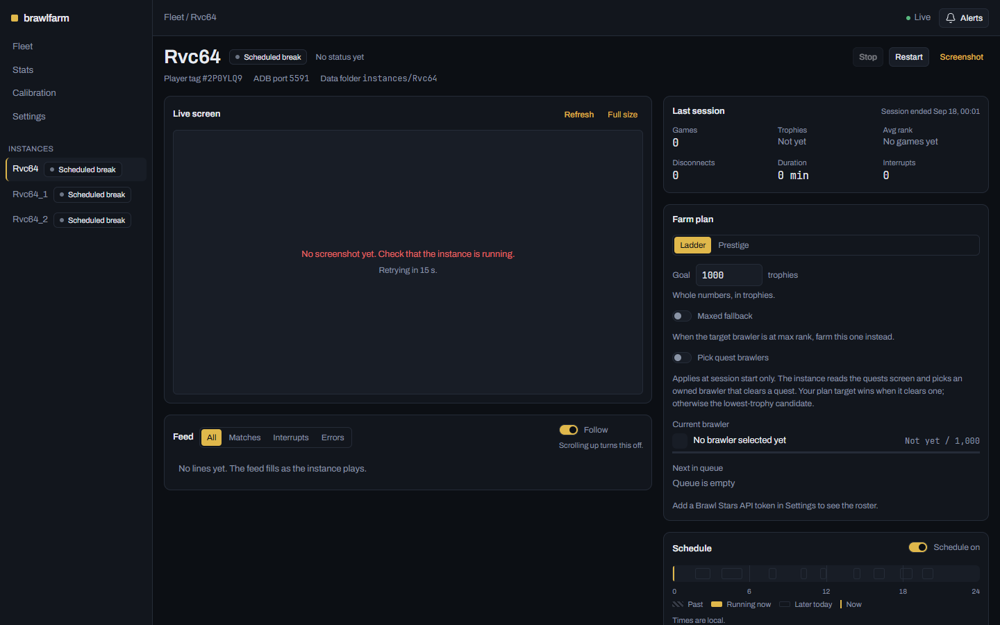
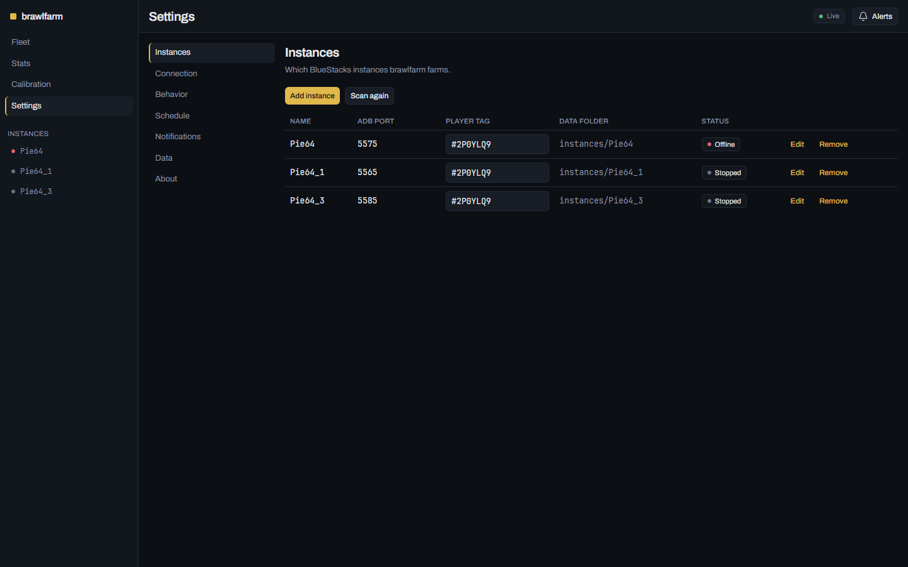
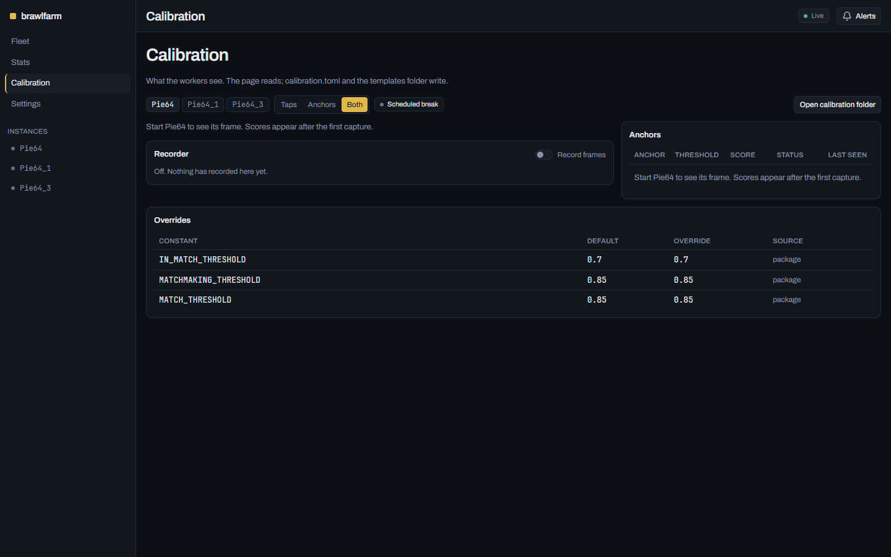

# brawlfarm



An open-source Brawl Stars trophy farmer for BlueStacks on Windows, with a local control panel in your browser.

**Install:** `uv tool install brawlfarm` (Windows 11, BlueStacks 5 with adb on, Python 3.13 and [uv](https://docs.astral.sh/uv/))

## What it does

- **Farms Trio Showdown:** queue, play, results, back to the menu, repeat.
- **Survives interruptions:** rewards, popups, rank-ups, disconnects, crashes, freezes, team invites.
- **Two farm modes:** ladder (the whole roster in 100-trophy tiers) or prestige (one brawler to 1000 at a time), plus an optional maxed fallback.
- **Anti-ban scheduler:** human-shaped sessions with breaks, on by default.
- **Many instances:** several BlueStacks instances at once, one worker per instance.
- **Local panel:** live screens, activity feed, farm plan, schedule, stats, settings and calibration.
- **Alerts:** webhook, ntfy and a healthchecks.io ping on every supervisor tick.
- **Never spends:** never taps ACCEPT on a team invite, GET or Upgrade, EQUIP NOW, any shop buy button, the pass VAULT, or anything priced in gems; never blind-taps in the shop.
- **Checks before it taps:** every navigation verifies the screen and bails to the menu on a failed check, so stale coordinates become logged no-ops.
- **Stops by PID:** a worker is stopped by the PID in its instance's status file, never by name.
- **No AI in the loop:** deterministic OpenCV template matching and OCR.

The last four are safety rails: absolute, and enforced in code and in review.

## Requirements

- Windows 11.
- BlueStacks 5 (the nxt line) with Android Debug Bridge enabled.
- Each instance's display at 1600 x 900 and pixel density 240.
- Python 3.13 and [uv](https://docs.astral.sh/uv/).

Hardware sizing and the play extras: [docs/install.md](docs/install.md#requirements).

## Install

```
uv tool install brawlfarm
```

Or clone the repository and `uv sync`. The desktop window, play stream and GPU extras are in [docs/install.md](docs/install.md#install).

## Running

```
brawlfarm
```

Supervises every instance and opens the panel at `http://127.0.0.1:8765/`; the wizard at `/setup` finds adb, lists your instances and checks their display. From a checkout: `uv run brawlfarm`. Flags: [docs/install.md](docs/install.md#running).

## More docs

- [Setup walkthrough](docs/setup.md): BlueStacks to first session, step by step.
- [Install and run](docs/install.md): hardware, extras, flags, `config.toml`.
- [Panel and API](docs/api.md): endpoints, live events, notifications.
- [Shadow mode](docs/shadow-mode.md): the detector beside the farm loop.
- [Calibration](docs/calibration.md): what the workers see, and overrides.
- [Platform support](docs/platform-support.md): what a port would replace.
- [Development](docs/development.md): build, test and contribute.
- [Play training](docs/play-training.md), [showdown maps](docs/play-maps.md), [releases](docs/release.md).

## Status

v1.1.0, the panel pass over copy, the component kit, fleet, instance, stats, settings, calibration and narrow screens; every phase in the plan has shipped. Main has since added the Stats placement pass and the play-mode kits: dataset, HUD reader, detector shadow mode and showdown maps.

## Screenshots

The panel, running against a scratch data directory with three example instances on a scheduled break, with nothing listening on their adb ports.


Instance: the live screen, the farm plan, the day's schedule and the session so far.


Settings: instances, connection, behavior switches, notifications, data and about.


Calibration: what the panel looks for on the screen, the recorder and observe switches, and the thresholds in force.

## Contributing

Bug reports and pull requests are welcome; see [CONTRIBUTING.md](CONTRIBUTING.md). A change to the never-tap logic or the safety rails is not merged on any other merit.

## Legal

Not affiliated with or endorsed by Supercell. Brawler art is served from the Brawlify CDN and belongs to Supercell under its fan content policy. Showdown map grids come from Brawl Stars game data (version 69.230) via github.com/tailsjs/brawl-stars-assets at commit cc307ff; see [docs/play-maps.md](docs/play-maps.md). Automating the game may violate its terms of service; use at your own risk. MIT licensed.
